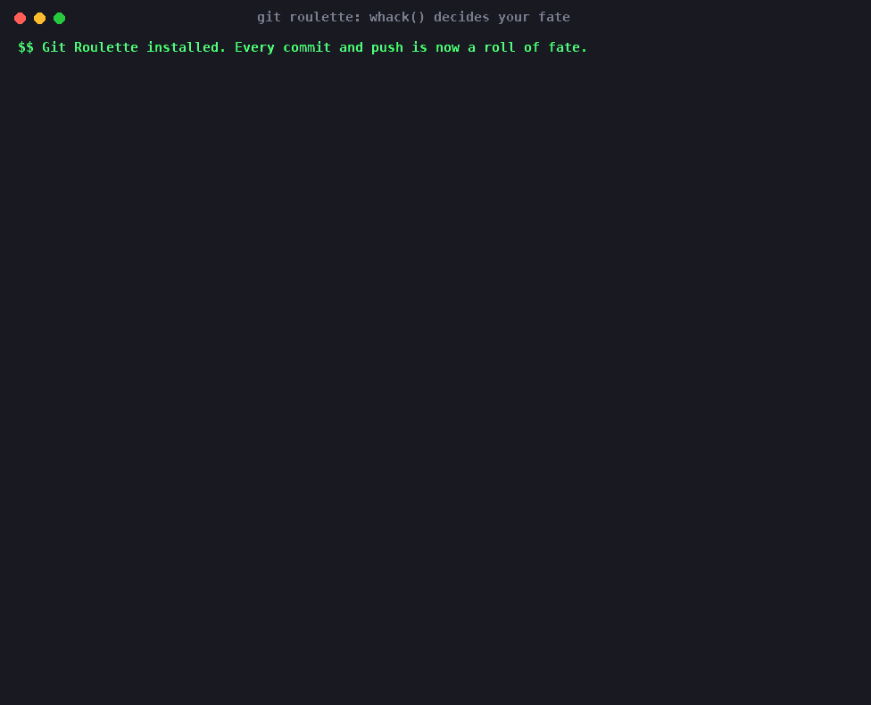
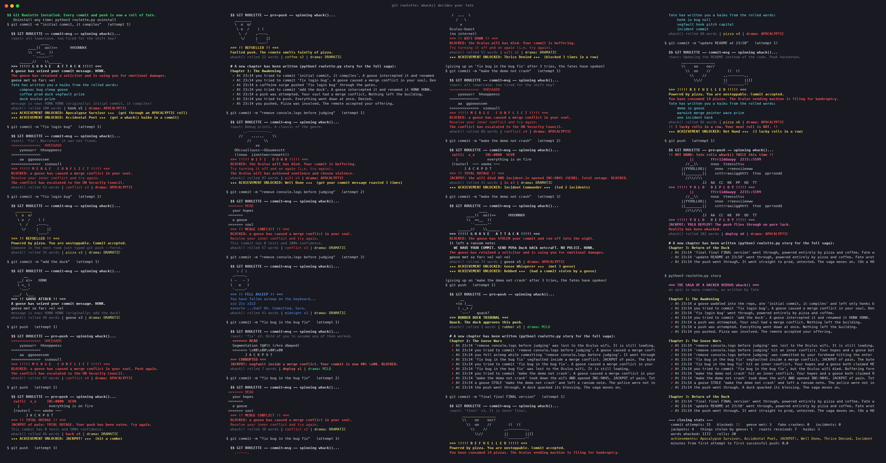

# Git Roulette 🎰

**By:** Ananth Iyer (GitHub [AnanthIyer21](https://github.com/AnanthIyer21))

**Pitch:** `whack()` decides the fate of every commit you make. Install it into a repo and every `git commit` and `git push` becomes a pull on a fruit machine run by geese, ducks, sponsors and the Oculus wifi.

## Screenshot



*The reel spins, a goose steals the very first commit and leaves a ransom note, the Oculus wifi achieves sentience, and fate writes haiku out of the rolled words.*



*A full `ROULETTE_SEED=2 bash demo.sh` run: 4 jackpots, 11 blocks, a goose heist, 3 haiku, 9 achievements, and the saga it all turned into.*

## How to run it

Python 3, standard library only. Works on macOS and Linux.

```sh
# the quick version: throwaway repo + local remote under /tmp, ~8 commits, 3 pushes, then the saga
bash demo.sh

# the real version: curse your own repo
python3 roulette.py install path/to/your/repo
cd path/to/your/repo
git commit -m "fix login bug"      # spin the wheel
git push                           # spin it again, then read your new chapter
python3 .git/roulette/roulette.py story     # the whole saga of your struggle
python3 .git/roulette/roulette.py uninstall # restore your old hooks
```

## How fate is decided

Every hook run calls `whack()` once. The 42 words are split into 12 fates. Each fate scores the number of its words that came up, averaged over its word count (so the lonely `conflict` and `wifi` can beat the eight-word sponsor lobby). The highest score wins; ties are broken at random. The number of words rolled sets the **drama**: 1–20 is MILD, 21–60 is DRAMATIC and 61–100 is APOCALYPTIC, which doubles the size of the ASCII art and makes the snoring longer.

The words spin past like a fruit machine reel, slow down and land on your fate. Then you get ASCII art, a verdict and a stats strip: `whack() rolled 57 words | goose x6 | drama: DRAMATIC`.

| Fate | Words | On `git commit` | On `git push` |
|---|---|---|---|
| SHIPPED | push, deploy, prod, merge, commit | Celebration, commit goes through | Straight to prod |
| CONFLICT | conflict | **BLOCKED**: "a goose has caused a merge conflict in your soul" | **BLOCKED** |
| GOOSE | goose, honk | Message rewritten to `HONK HONK (originally: ...)`, or the goose **steals** it | The goose honks you off the premises |
| RUBBER DUCK | duck, quack, rubber | The duck asks you a question. Give a weak answer and you are **BLOCKED** | Quack of approval |
| SLEEP | sleep, midnight | You fall asleep on the keyboard (zzz), then it commits | Snores, then pushes |
| SEGFAULT | segfault, null, pointer, stack, overflow, bug | Fake core dump with backtrace... "just kidding" | Fake crash, then pushes |
| INCIDENT | incident, io | Declares an incident.io `INC-####` (SEV by drama) and tags the message | Incident "resolved" |
| WIFI | wifi | **BLOCKED**: "the Oculus wifi has died" | **BLOCKED** |
| FUEL | pizza, coffee | Powered by pizza or coffee | The remote smells of pizza |
| GLORY | prize, demo, pitch | "THIS COMMIT WINS THE HACKATHON" | Shown at the closing ceremony |
| SPONSORED | marshall, wace, brevan, howard, capital, one, bloomberg, netcraft | A sponsor acquires or trades your commit (Bloomberg-style headline) | Same, for your push |
| CHAOS | whack, hack, feature, warwick, oculus, compsoc, semicolon | `semicolon` appends `;`, `feature` rebrands your bug, `hack` SHOUTS it, `whack` WHACKS it | Chaos, but it pushes |

Blocked? Just try again. Fate never blocks you forever.

## Even more ways for whack() to ruin your night

- **🎰 Jackpots.** If the two highest-scoring fates form a known pair, they combine:
  - **BIRD FIGHT** (goose + duck): they brawl over your commit. Blocked.
  - **LATE NIGHT SLICE** (pizza + sleep): you face-plant into a pizza, and the commit goes through.
  - **HOSTILE TAKEOVER** (sponsor + glory): your commit gets bought out.
  - **TOTAL OUTAGE** (wifi + incident): a SEV0. Blocked.
  - **CORRUPTED** (segfault + conflict): blocked.
  - **YOLO DEPLOY** (chaos + shipped): STRAIGHT TO PROD.
- **🪿 Goose heists.** A goose sometimes steals your commit or push outright and leaves a ransom note cut out of the rolled words: `WE HAVE YOUR COMMIT. SEND PUSh Duck hACk netcraFT. NO POLICE. HONK.`
- **🪿 The goose stalks you.** Every goose you meet is counted. On the 5th, the geese move into your repo, and your next 3 commits get a `HONK` prefix.
- **🦆 Duck interrogation.** The duck asks a real question ("Did you test it?") and judges the answer. Say "yes" and it calls you a LIAR, because nobody tests at a hackathon.
- **🔥 Lucky streak.** After 3 lucky rolls in a row you get a HOT HAND: fate calls `whack()` *twice* for your next roll, so you get double the words, the drama and the art.
- **📜 whack() haiku.** Survive an APOCALYPTIC roll and fate writes you a 5-7-5 haiku from the words it rolled (it counts the syllables). The haiku goes into your commit message body, forever.
- **🔥 Commit roasts.** Before it spins, fate reads your commit message: `'fix' x2. Bold of you to assume any of them worked.`, `'final' x3. It is never final.`, `Committing at 23:58. The deadline can smell your fear.`
- **📈 Absurd escalation.** On APOCALYPTIC rolls the goose sues you, the ducks unionise and Bloomberg halts trading on your repo.
- **★ Achievements.** There are 12 to unlock: Goose Whisperer, Thrice Denied, Robbed, Accidental Poet, Hot Hand, JACKPOT!, Midnight Committer and more.

## The saga

Every roll is logged to `.git/roulette/log.jsonl`. `story` turns it into an epic told from hand-written templates, with a chapter for every successful push and closing stats (attempts, blocks, geese met, fake crashes, minutes until your first successful push):

> **Chapter 2: The Goose Wars**
> ✗ At 23:14 'fix bug in the bug fix' segfaulted inside a merge conflict. JACKPOT of pain. The bytes are screaming. Fate's review: "'fix' x2. Bold of you to assume any of them worked."
> ✗ At 23:14 'make the demo not crash' took down the wifi AND opened INC-9045. JACKPOT of pain. Total outage.
> ✗ At 23:14 a goose STOLE 'make the demo not crash' and left a ransom note. The police were not informed.
> ✓ At 23:14 the push went through. A duck quacked its blessing. The saga moves on.

After each successful push, the newest chapter is printed right there in your terminal. It's all offline, with no API keys.

## Is it harmless?

Yes.
- It only touches `.git/hooks/commit-msg`, `.git/hooks/pre-push` and `.git/roulette/` in the repo you install it into. Existing hooks are backed up, and `uninstall` puts them back.
- `whack()` runs inside `.git/roulette/`, so the `whack` fate file never ends up in your working tree.
- If anything goes wrong in a hook, it apologises and lets git carry on (it fails open).
- `demo.sh` only writes under `/tmp`. It needs no network and no pip installs.
- `NO_COLOR` is respected, and nothing is animated when output isn't a terminal. With no TTY (or `ROULETTE_NONINTERACTIVE=1`), the duck reads its answer from `ROULETTE_DUCK_ANSWER`.

## Files

- `roulette.py` is the whole tool (install, uninstall, story and the hooks)
- `whack.py` is the official function, unchanged
- `demo.sh` is the non-interactive demo (`ROULETTE_SEED=2 bash demo.sh` reproduces the screenshot)
- `render_screenshot.py` and `render_gif.py` turn the coloured demo output into `screenshot.png` and `demo.gif` (they use Pillow, but only to make the images)
