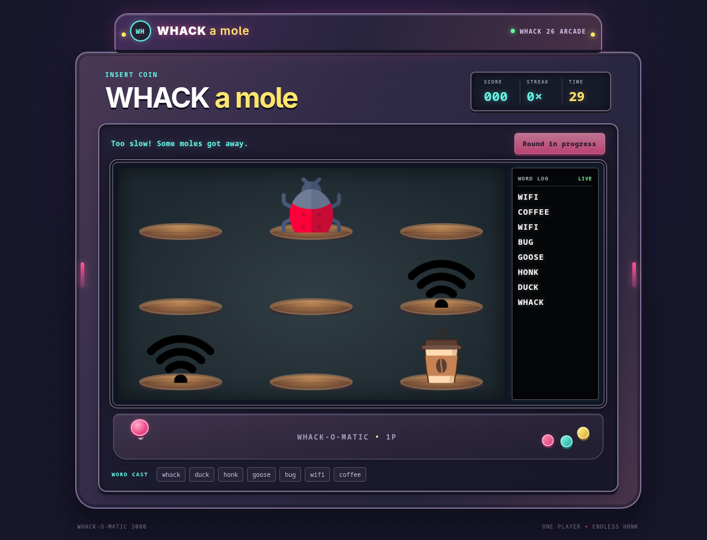

# WHACK a mole

**By:** Freddie Audley

**Pitch:** A neon arcade cabinet where `whack()` summons a different cast of hackathon-themed moles.

## How to run it

From the repository root, run:

```sh
cd submissions/Freddie-Audley
node server.js
```

Then open [http://127.0.0.1:4173](http://127.0.0.1:4173). Click **Start Game** and whack the characters before they disappear. One to four moles can pop up together; each hit scores 10 points, and a streak adds bonus points.

The provided `whack()` function supplies the words in appearance order. The returned words seed the round's predictable-but-unrepeatable spawn pattern, including the number and positions of simultaneous moles. When a file's words run out, the game calls `whack()` again and continues with the next file's words. Every possible word has its own character PNG in `resources/`, displayed directly as the mole.

The arcade screen's word log records each word as its mole appears, newest first.

## Screenshot

