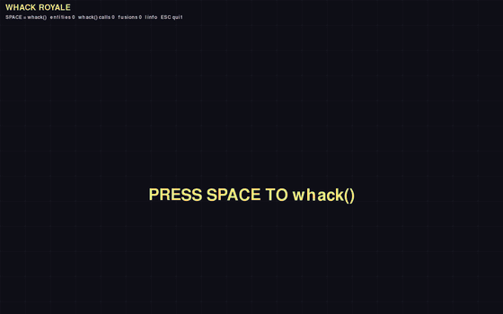
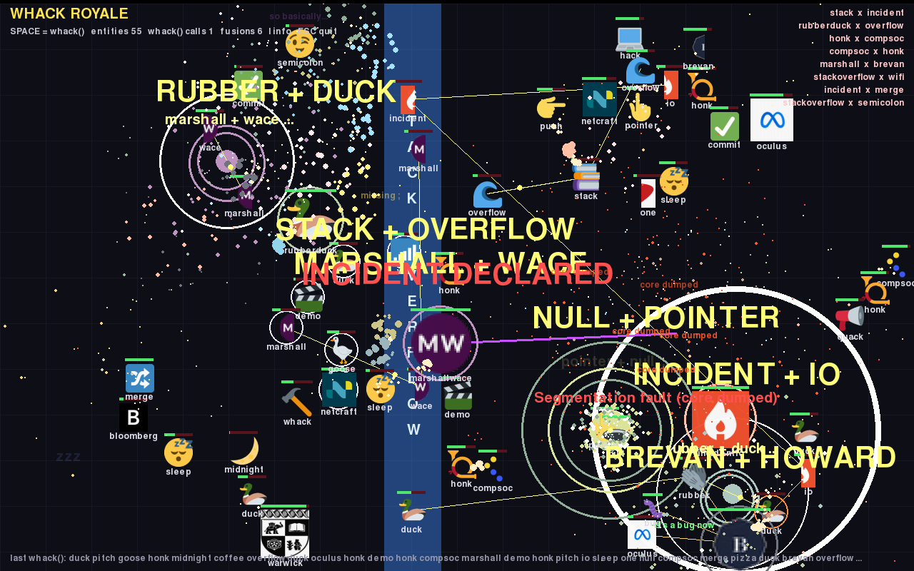

# WHACK ROYALE

**By:** Josh Turner (jamman214)

**Pitch:** Press SPACE and every word `whack()` returns becomes a fighter in a free-for-all battle royale. Split sponsors hunt down their other half to fuse into bosses, and `whack` units keep calling `whack()` to bring in more fighters.

## How to run it

```
pip install pygame-ce
python battle.py
```

## Controls

| Key | Action |
|---|---|
| SPACE | Call `whack()`: 1–100 fighters burst in at once |
| I | Boss info screen: every fusion, its HP and its attack (pauses the battle) |
| ESC | Quit |

`python battle.py --test` runs a headless self-check.

## Demo



Full-quality version: [demo.mp4](demo.mp4)

