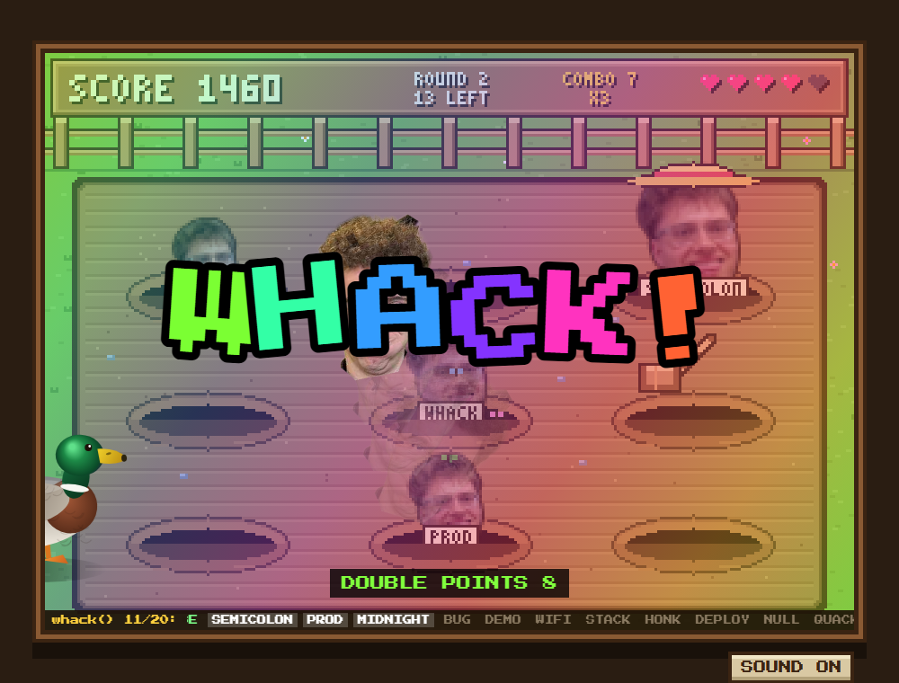

# WHACK-A-WHACK()

**By:** MikeyMictan1

**Pitch:** Whack-a-mole where every mole is a word from `whack()` in order. Ft. Jakub and Ed, DCS Geese, Nuclear Warfare, 7D time travel, Flooding, bomber ducks, natural disasters, and more chaos :). 

> ### 🔊 PLAY WITH SOUND ON. IT MAKES IT 100X BETTER. 🔊

## How to run it

From the repo root:

```
cd submissions/MikeyMictan1
python run.py
```

(Use `python3` if `python` isn't found.)

- 🔊 **Turn your sound up first.**
- Needs only Python 3.9+, and it opens in your browser.
- Opening `game.html` directly also works.

## How it uses `whack()`

- **Each round is one `whack()` call.** Every word it returns becomes a mole, in order.
- **Short word = less time to whack it,** but more points.
- **Live ticker** at the bottom shows `whack()`'s words in order as you play.
- **End-of-round recap** blasts every word from the `./whack` file onto the screen in order, marked hit or missed.
- **WHACK** appears → double points for 10s. **HACK** appears → half points for 5s.
- Each mole says its word out loud (text-to-speech).

## Chaos

- A random event every 3 seconds: exploding duck, spinning chicken, angry goose, earthquake, flood, lights out, upside down.
- pookie2 flies across the screen every 3–5 seconds.
- Lose all 5 lives and a goose nukes the farm.
- Lots of silly synthesised sound effects, plus background music. **Seriously, play with sound.** 🔊

## Screenshot


