# Grammar vs The Deadline

**By: Savva — third-year Discrete Maths student at the University of Warwick.**

**Pitch:** An epic adventure where words become heroes and battle the Deadline.

A duck can quack, a production server can deploy, and a **MIDNIGHT RUBBER GOOSE** can honk twice with double power. Sponsor names fuse into legendary recruits; `stack overflow` drops actual stack frames onto the boss. Sometimes the function returns barely enough words to assemble an army. That is part of the joke.

The returned words, in their original order, determine the army, its attacks, its resources and the length of the battle. You start a run and watch the sentence fight itself into a story. **This is an iterative prototype under development for the One Hour Hack.**

## See it

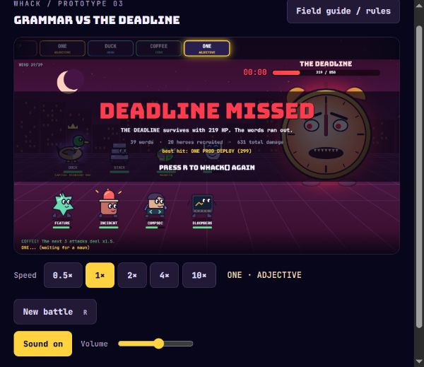

*Prototype 03 after a battle: the words ran out, the Deadline survived, and R gives the next sentence another chance.*

## Run it

Requires **Node.js** and a modern browser. **No npm packages, install step or build step.** From the repository root:

```sh
cd submissions/Nosohvost
node server.js
```

Open **[localhost:3000](http://localhost:3000)**, then click **Start battle · QUACK**. The opening click unlocks Web Audio and plays the bundled duck quack. The battle runs automatically; there is no manual aiming or team selection.

| Control | What it does |
| --- | --- |
| 0.5× / 1× / 2× / 4× / **10×** | Select playback speed; 1× is the default. |
| Hold Space | Temporarily use 4×, then return to the selected speed on release. |
| New battle / R | Request a fresh `whack()` word list and restart. |
| Field guide / rules | Pause and open the rules and sprite gallery; Close or Escape resumes. |
| Sound on / off; Volume | Mute effects or adjust their level; default volume is 55%. |

Entrances, attacks, multi-hits, retaliation and deaths play in sequence, with reading pauses. Speed changes viewing time, not damage or turn count. The clock advances with the word list rather than imposing a real-time play limit. Google Fonts enhance the lettering when available; local fallback fonts are defined.

## Why `whack()` matters

[`server.js`](server.js) serves the game and exposes `GET /whack`. Every new battle requests that endpoint, which calls the official [`whack.js`](whack.js) and returns its words. The submission's copy is **unmodified and byte-for-byte identical** to [`function/whack.js`](../../function/whack.js).

The official function chooses 1–100 words from its 42-word vocabulary, writes them to the submission's `whack` file, and returns them in order. That generated file is ignored by Git. [`engine.js`](public/engine.js) interprets the sequence; [`game.js`](public/game.js) animates its events on a 1280×720 canvas. Combat also has random damage, critical hits and targeting, so a word list is a battle script rather than a guaranteed outcome. If the endpoint fails, the renderer has a four-word duck/goose fallback; normal server-backed runs use the official function.

## Rules at a glance

**Beat THE DEADLINE's 850 HP before the words run out.** An empty party does not end the run: later nouns can still recruit heroes. These word roles are specific to the game.

| Word role | Battle effect |
| --- | --- |
| Nouns | Recruit into eight slots; reuse empty/dead slots first, otherwise the oldest recruit leaves. |
| Adjectives | Wait for the next recruit and stack modifiers on it. |
| Verbs | Act through the latest recruited living hero, falling back to the newest survivor. With no hero, the action is wasted. `sleep` heals instead of attacking. |
| Items | `pizza` heals living heroes by up to 30 HP; `coffee` adds three charges of 1.5× damage, one per attack action. |
| Adjacent pairs | Fuse before ordinary word roles: five legendary recruits, `null pointer`, `stack overflow` or `merge conflict`. |
| Waiting sponsor partners | Marshall/Wace, Brevan/Howard and Incident/IO also fuse across occupied living slots, in either order. Capital/One can match while both modifiers are pending. |

**Combos:** consecutive attack verbs by the same hero gain **1× → 1.5× → 2× → 2.5×…** chain damage. **COMBO x2 means the second attack, with a 1.5× chain multiplier.** Recruiting resets the chain; adjectives and items interrupt it. Sleep heals up to 40 HP without incrementing the chain, but counts as a preceding verb for the next attack. The fused `stack overflow` attack can also continue a chain. See the [full rules](RULES.md#combos-and-signatures) for sleep's counter-preserving exception.

**Signatures** multiply damage again: duck + quack, goose + honk, demo/bloomberg + pitch, feature + commit/push, compsoc/bug + hack and netcraft + deploy get **2×**; prod + deploy and rubber duck + quack get **3×**. For example, in `duck quack quack`, the second quack has a 1.5× chain bonus on top of its 2× signature bonus.

The boss retaliates against a random living hero every **five processed tokens** for **22–40 damage**, multiplied by 1.5 below 30% boss HP. Adjacent fused pairs count as one token; separated partner words still count individually. Defeating the boss prevents retaliation and produces **SHIPPED!**; exhausting the sequence produces **DEADLINE MISSED**.

See **[the full rules](RULES.md)** for every modifier, fusion, attack value and damage quirk. The in-game field guide also explains the core mechanics.

## All 28 recruit sprites

These are the individual SVGs used by the game: **22 ordinary recruits, five legendary fusions and one self-destructing exception**. Proposed review alternatives are separate.

**Campus creatures and community (6)**

<p>
  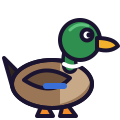
  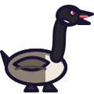
  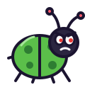
  
  
  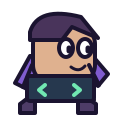
</p>

Duck · Goose · Bug · Feature · Oculus · CompSoc

**Sponsor-name recruits (8)**

<p>
  
  
  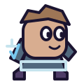
  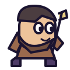
  
  
  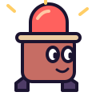
  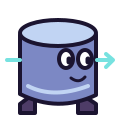
</p>

Marshall · Wace · Brevan · Howard · Bloomberg · Netcraft · Incident · IO

**Hackathon survival and software (8)**

<p>
  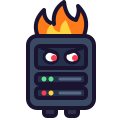
  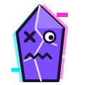
  
  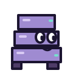
  
  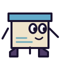
  
  
</p>

Prod · Segfault · Pointer · Stack · Semicolon · Demo · Prize · WiFi

**Legendary fusions (5)**

<p>
  
  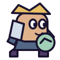
  
  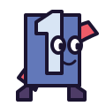
  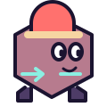
</p>

Rubber Duck · Marshall Wace · Brevan Howard · Capital One · Incident IO

**Exception recruit (1)**

<p>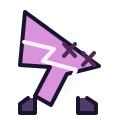</p>

Null Pointer — joins, crashes into the boss, then dies.

<details>
<summary>Field-guide screenshot (Prototype 02, partial roster view)</summary>

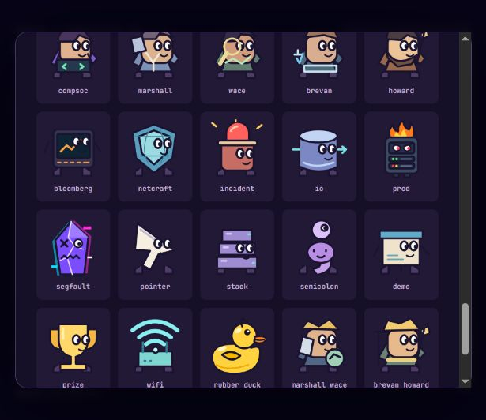

This is a partial scroll view; all 28 individual sprites are displayed above.

</details>

## Visual review gallery

Open **[the live review gallery at localhost:3000/review.html](http://localhost:3000/review.html)** after starting the server. **[public/review.html](public/review.html)** is the gallery's HTML source in this repository; GitHub displays the source and does not execute its canvas animations.

Generated by [`build-review.js`](build-review.js), the page uses the **actual game renderer** for **54 loop cards: 14 attacks** (including the boss), **six other events, 28 recruits and six adjective modifiers**, with Pause/Resume controls. These are silent live canvas loops, not GIF exports. The comparison section shows **six current/proposed art pairs** and **three boss options**: the current Deadline plus two proposals.

**Alternatives are review candidates only.** No proposed recruit or boss is selected in the game, and no alternative-art selector is implemented. Scope Creep is a boss concept, not a new implemented rule set. The game uses the SVGs above and the canvas-drawn Deadline clock.

<details>
<summary>Attack and event review index</summary>

| Category | Where to look / current game visuals |
| --- | --- |
| [Melee attack reviews](http://localhost:3000/review.html) | `whack`: dash and hammer arc; `push`, `merge`, `conflict`: contact dashes; Null Pointer's `crash`: dash and pink explosion. |
| [Ranged attack reviews](http://localhost:3000/review.html) | `quack`/`honk`: yellow/white sound-wave rings; `deploy`: rocket; `commit`: green check; `hack`: code stream; `pitch`: spinning slide; `overflow`: glowing orb. |
| [Ultimate and boss attack reviews](http://localhost:3000/review.html) | `stack overflow`: falling stack-frame blocks; boss retaliation: lightning and lunge. |
| [Six event reviews](http://localhost:3000/review.html) | Heal, coffee, sleep, merge-conflict backfire, death and joining. |
| [Recruit animation reviews](http://localhost:3000/review.html) | All 28 recruits; walking/idle motion and legendary rings/crowns. Departures and tombstones also appear during normal battles. |
| [Six modifier reviews](http://localhost:3000/review.html) | Midnight violet aura; capital size increase; rubber bounce; null translucency; one crown; Warwick scarf. Two-hit and zero/999 damage outcomes occur in normal battles; see [modifier rules](RULES.md#adjective-modifiers). |
| Hit feedback in attack loops and battles | Floating damage/tags, particles, boss flash/knockback and shake. Normal combat also displays criticals, misses, combos, signatures, caffeine and wasted-verb echoes. |
| Stage and outcomes in normal battles | Campus skyline/grid floor, token ribbon/log, clock progression and low-HP enrage; SHIPPED! with confetti or DEADLINE MISSED with statistics. See the battle screenshot above. |
| [Art comparisons](http://localhost:3000/review.html) | Six recruit pairs: Duck, Goose, Bug, Prod, Segfault and Rubber Duck; current Deadline plus redrawn Deadline and Scope Creep proposals. Review only. |

</details>

<details>
<summary>Review screenshots</summary>

These captures document the separate review gallery. Open the live page above to see its animations.

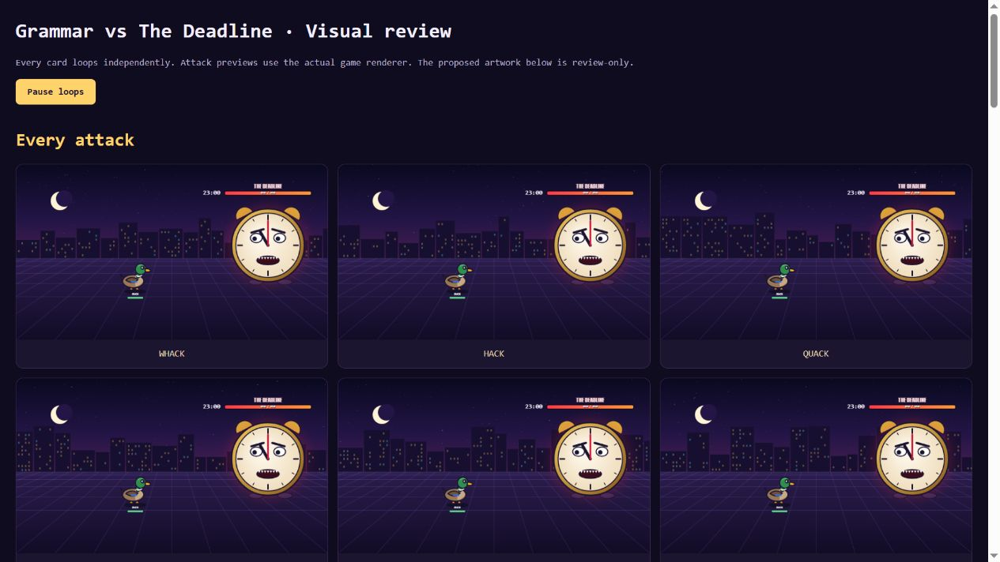

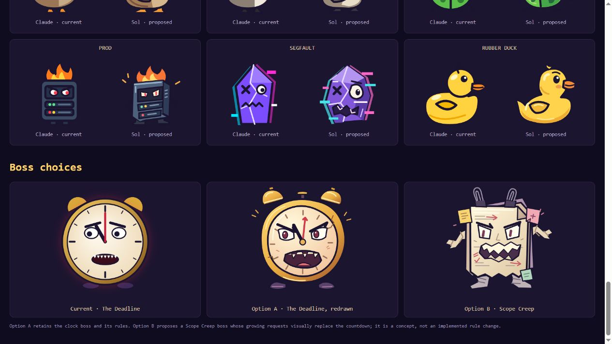

</details>

## Sound in Prototype 03

[`audio.js`](public/audio.js) provides **30 procedural cues plus the sampled quack**: distinct attack sounds, impacts/criticals/misses, ordinary and legendary joins, departures/deaths, modifiers, healing/items, boss retaliation and win/loss, plus quiet walking footsteps and token clock ticks. Start Battle unlocks Web Audio; starts/restarts and quack attacks play the locally bundled duck sample. Other effects are generated locally with Web Audio. Mute and volume controls are available; the field guide stops active sounds while the action is paused.

The quack uses the supplied **quack_5.mp3**, unchanged, in place of the earlier incorrect sample. See [sound credits and file hash](public/audio/CREDITS.md).

## Optional checks and code guide

From the submission folder:

```sh
node verify-prototype.js
node verify-audio.js
node verify-fusions.js
node sim.js 1000
```

`verify-prototype.js` checks all 28 sprite files, action sequencing/completion, clean restarts and identical seeded combat results at 0.5×/1×/2×/4×/10× using a minimal canvas host. `verify-audio.js` checks sample playback, procedural cues, mute, volume and pause cancellation with a simulated audio context; actual sound quality still needs a browser listen. `sim.js` estimates random win rates, not guaranteed wins.

For review: [combat engine](public/engine.js) · [renderer and controls](public/game.js) · [sound effects](public/audio.js) · [in-game field guide](public/rules.js) · [sprite generator](generate-sprites.js) (source for the 22 added SVGs).
