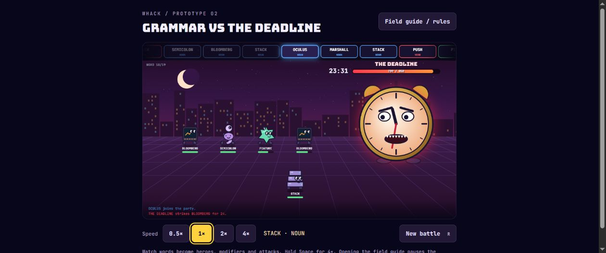

# Grammar vs The Deadline

**By:** Nosohvost

**Pitch:** A random word list becomes a marching army of nouns, adjective modifiers and verb attacks against an angry deadline clock.

## Run

Requires Node.js, with no packages to install:

```sh
cd submissions/Nosohvost
node server.js
```

Open http://localhost:3000. The server calls the official, unmodified `whack.js` for every new battle. Its output file is ignored by Git.

## Prototype 02

- All 28 recruit types have original SVG sprites; the six existing sprites are retained and 22 new ones added.
- Slower default playback: words, entrances, attacks, multi-hits, retaliation and deaths play in sequence, with reading pauses.
- Buttons select 0.5×, 1× (default), 2× or 4×. Hold Space temporarily for 4×. R or New battle calls `whack()` again.
- Field guide / rules pauses the battle and shows the complete combo, fusion and modifier rules plus a sprite gallery. Close it or press Escape to resume.
- Hero rows and labels are separated; attack tags appear below the boss status area.

## Rules

Defeat 850 boss HP before the words run out. These are game-specific word categories. Nouns recruit heroes (eight slots, replacing the oldest when full). Adjectives stack on the next recruited hero. Verbs use the most recently recruited living hero, falling back to the newest survivor. A verb without a hero is wasted.

Consecutive attack verbs increase damage by 50 percentage points each: **1× → 1.5× → 2× → 2.5×**, continuing upward. The displayed combo count is the attack number, not its damage multiplier. Nouns reset the chain; adjectives and items interrupt it. Sleep heals up to 40 HP without incrementing the chain, but counts as a preceding verb for the next attack.

| Signature | Extra multiplier |
| --- | --- |
| duck + quack; goose + honk | 2× |
| demo + pitch; bloomberg + pitch | 2× |
| prod + deploy | 3× |
| feature + commit / push | 2× |
| compsoc + hack; bug + hack | 2× |
| rubber duck + quack | 3× |
| netcraft + deploy | 2× |

Fusions require adjacent words in the listed order, recognized before ordinary word categories:

| Pair | Effect |
| --- | --- |
| rubber duck | Legendary hero; heals party 30 HP on arrival |
| marshall wace; brevan howard; capital one; incident io | Legendary hero, 2.6 power and 160 HP |
| stack overflow | 150 base damage through the current hero, before multipliers |
| null pointer | Recruits a hero that deals 180–240 damage and dies |
| merge conflict | All living heroes lose 20 HP |

| Adjective | Effect |
| --- | --- |
| midnight | 2× power, purple aura |
| capital | 1.4× power, 1.3× HP and larger sprite |
| rubber | Two hits at 75% damage each; bounce |
| null | Each hit: 15% chance of 999 damage, otherwise zero; translucent |
| one | 1.3× power, 1.5× HP; crown |
| warwick | 1.2× power and +40 HP; scarf |

Pizza heals living heroes by 30 HP; coffee adds three charges of 1.5× damage (one charge per attack action). Damage varies 85–115%, with a 10% critical chance for double damage. WiFi misses 40% of attacks; Segfault adds a random 0–3× multiplier. Conflict costs the acting hero 10 HP.

The boss retaliates every five processed tokens against one random living hero for 22–40 damage, boosted 1.5× below 30% boss HP. Fused pairs count as one token. Killing the boss prevents retaliation.

## Checks

```sh
node verify-prototype.js
node sim.js 1000
```

The first runs the real animation loop with a minimal canvas host, checking identical combat outcomes at every speed, completion after all queued effects, no words starting during unfinished movement/attacks, and clean restarts. The second estimates random win rates. Browser checks cover controls, the rules dialog, and SVG rendering.

The rules table reads signature bonuses from the engine. `generate-sprites.js` is the editable source for the 22 new SVGs.

## Screenshot


