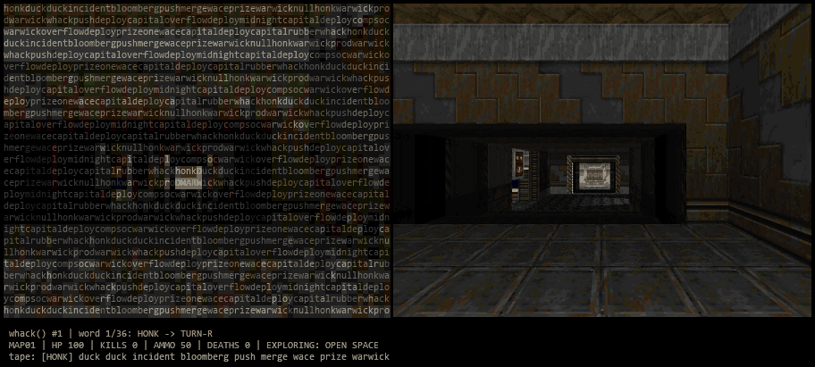

# Can whack() run Doom?

**By:** Binh (Discord: sirsaltysalmon) 

**Pitch:** `whack()` plays Doom. Every call writes a controller tape, every word on it is a button press, and the game is drawn in your terminal out of those same words. The words can't aim, so the game aims them: `whack` really does whack the nearest zombie.

## How to run it

```
pip install -r requirements.txt
python main.py
```

The game opens in its own window, and the terminal shows the same view drawn in words. Ctrl+C to stop. Extras: `--no-window` for terminal only, `--rounds 5` stops after 5 calls to `whack()`, `--gif out.gif` records a clip.

It runs the real Doom engine through [ViZDoom](https://github.com/Farama-Foundation/ViZDoom), using the free, open-source [Freedoom](https://freedoom.github.io/) game files that come with it. You don't need a copy of the commercial game.

## How it works

1. Call `whack()`. It writes 1–100 words to the `whack` file.
2. Read the `whack` file back as a **controller tape** and play it into the game, 4 tics (about 1/9 s) per word.
3. **Guide the words.** The tape decides *when* to act and *what kind* of action it is. The game decides *where*:
   - **Monster on screen:** fire, move and turn words lock onto the nearest live monster. Fire words wait until it's lined up.
   - **Pickup on screen:** move and turn words head for it (unless it's been stuck in one spot for 3 s, then it gives up on it).
   - **Otherwise, real pathfinding** ([`pathfinder.py`](pathfinder.py)): it reads every wall of the level into a 16-unit grid (walls, ledges too tall to climb and closed doors), remembers where it's been, and runs a breadth-first search to the nearest place it hasn't been yet. Move words follow the route, and pressing use on the way opens doors. If it's stuck for 2 s, it routes around that spot for a while.
   - Fire words with nothing to shoot whack the wall instead. If the whole level is explored, it falls back to wandering down the most open corridor.
4. Draw every frame in the terminal. Each character is a letter from the tape, coloured by the pixel underneath it. Bright spots are drawn in CAPITALS.
5. When the tape runs out, call `whack()` again. Dying respawns you; finishing a level loads the next one.

The HUD under the picture shows the current word, which buttons it really pressed, and what it's going for (`LOCKED ON: ZOMBIEMAN`, `GOING FOR: HEALTHBONUS`).

Every one of the 42 words does something:

| Words | Button |
|---|---|
| `push` `merge` `commit` `feature` `hack` `pitch` | forward |
| `deploy` `prod` `pizza` `coffee` | sprint forward |
| `whack` `bug` `segfault` `null` `pointer` `incident` | **fire** |
| `demo` `prize` | charge forward firing |
| `goose` `honk` and the sponsors | turn (geese and sponsors steer) |
| `duck` `quack` | strafe left / right (ducks dodge) |
| `conflict` `overflow` `stack` | back off |
| `io` `rubber` `wifi` `semicolon` | open doors |
| `sleep` `midnight` | do nothing, you passed out |

## Screenshot

The terminal view on the left, the real game on the right.


