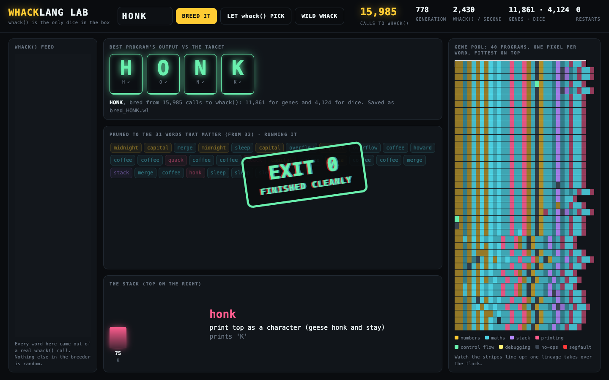

# Whack Arcade

**By:** Arnav Popley (ap9)

**Pitch:** Five ways to take whack() seriously: a programming language, a Bitcoin-anchored blockchain, a provably fair casino seeded by a public randomness beacon, a drum machine and a round-the-world flight planner with live weather, all built from the same pile of random words.

## How to run it

Everything is Python 3.9+ standard library, with no API keys. The external APIs are all free and keyless: drand, mempool.space, Open-Meteo, Wikipedia and OpenStreetMap. Every hack still runs offline, it just loses the live parts.

```
cd submissions/ap9

python3 whacklang.py                  # whack() writes a program, WhackLang runs it
python3 whacklang.py evolve HONK      # breed a program that prints HONK (about a minute)
python3 proof_of_whack.py             # mine a blockchain where mining = calling whack()
python3 proof_of_whack.py tamper      # a goose edits history, verification catches it
python3 whack_casino.py odds          # the exact paytable and house edge
python3 whack_casino.py               # play the slot machine
python3 whack_casino.py verify ROUND PHRASE NONCE   # replay any pull from the public beacon

python3 whack_server.py               # then open http://localhost:8026
```

## Screenshot




## The five hacks

### 1. WhackLang: every whack() is a program

The 42 words are opcodes for a small stack machine working on bytes. `capital` pushes 65 (the letter A), `coffee` adds one, `honk` and `quack` print a character, `merge` adds, `conflict` subtracts, `overflow` multiplies, and `segfault` halts with `Segmentation fault (core dumped)`. Loops are `duck ... goose`: when the goose comes round, if the top of the stack isn't zero you go back to the duck. Sponsor words are no-ops ("sponsor slot") so random programs don't do too much.

`python3 whacklang.py` calls whack(), reads the program back out of the `whack` file and runs it. Most random programs print junk or hit the step limit in an infinite loop, which is very relatable.

`evolve` is the clever part. It keeps 40 programs, scores each by how close its output is to the target, and breeds the best ones. **Every mutation is a fresh whack() call**: a few words from its output get spliced into the parent. When the flock gets stuck it restarts from fresh whacks. Once it hits the target it deletes every word it doesn't need. `evolved_HONK.wl` is a real result after about 100,000 calls to whack():

```
capital coffee coffee coffee coffee coffee coffee coffee capital coffee midnight wifi segfault
merge coffee deploy pizza stack capital stack pizza commit one bloomberg quack sleep sleep null
one pointer sleep honk segfault

Output:  'HONK'
Ended:   Segmentation fault (core dumped) after 32 steps
```

It prints HONK and then segfaults. Evolution found the hackathon spirit on its own.

### 2. Proof of Whack: a blockchain where mining means calling whack()

Each block's SHA-256 hash is turned into a phrase of whack words. To mine the next block a miner must call whack() until the file it writes contains that exact phrase. The winning whack is stored in the block as its proof, so anyone can check it. Difficulty is the phrase length and adjusts itself, like Bitcoin: one word is instant, four words takes about 60,000 whacks. Transactions are written by whack() too ("honk pays duck 8 QUACK for prize").

```
Block 4: the chain demands "push brevan commit brevan"
  Duck Pool found it after 55,453 whacks (6.09s, 9,103 whacks/sec)
  proof: ...commit feature one PUSH BREVAN COMMIT BREVAN prod warwick rubber...
```

`tamper` rewrites a transaction in block 2 and `verify` flags it because the hash no longer matches.

**Anchored to real Bitcoin.** The genesis block's parent is the newest real Bitcoin block, fetched from mempool.space, so nobody can pre-mine the chain before Bitcoin mines that block. `verify` re-checks the anchor against Bitcoin. At the end it fetches Bitcoin's live hashrate and does the sad maths:

```
Genesis anchored to Bitcoin block 974998: 00000000000000000001628b66001cf4b3bacd09965b9f5bb73aff41cbc78b13
Bitcoin network right now: 1.02e+21 hashes/sec
Proof of Whack network:    11,409 whacks/sec
To catch up you'd need 8.9e+16 laptops calling whack(). Bring ducks.
```

### 3. Whack Casino: a slot machine with honest maths

The reels scroll up through the actual `whack` file and stop on its first three lines. Because whack() picks each word uniformly and the length uniformly from 1 to 100, every probability is exact. `odds` walks all 42³ = 74,088 reel results with Python fractions:

```
DUCK DUCK GOOSE                           2000     1 in 75,600
Three of a kind                            250     1 in 1,843.9
Full flock: three birds                     40     1 in 1,281.4
Jammed: whack wrote under 3 lines            0     1 in 50
Full whack (100 lines) doubles any win:            1 in 100
Return to player: 95.3895%   House edge: 4.6105%   (exactly 56089/58800)
```

`sim 20000` pulls the lever 20,000 times with real whack() calls and puts the observed counts next to the exact ones.

**Provably fair, using the League of Entropy.** whack() uses Python's `random` module, so seeding that module decides what whack() writes, without touching the function. When you pull, the machine commits to the *next* round of [drand](https://drand.love). drand is a public randomness beacon run by Cloudflare, Protocol Labs, universities and others, and it publishes a signed random value every 3 seconds. It waits for that round to appear, then seeds with the round's randomness, your lucky phrase and the pull number, and calls whack(). The house can't rig it and you can't predict it. Every pull prints a command that replays it from the public beacon:

```
  Nothing: no win   (whack wrote 66 lines)
  verify: python3 whack_casino.py verify 33763023 "warwick" 1

$ python3 whack_casino.py verify 33763023 warwick 1
drand quicknet round 33763023: 552bb979e3d6d4fdfd24cb3298b2515ef9ec7fdf568b035e9bd1fa63e1cf61ad
Replayed whack(): 66 lines, reels STACK | NULL | INCIDENT
```

### 4. Whack Machine: every whack() is a drum loop

Open `music.html` through the server. Each word is a sixteenth note: `segfault`, `deploy` and `prod` are kicks, `conflict` and `bug` are snares, `wifi` and `semicolon` are hi-hats, `overflow` is a noise sweep, and `null` and `sleep` are silence. Ducks quack and geese honk, synthesised live with Web Audio. Sponsors play the bassline and everything else plays a pentatonic lead. The number of words sets the tempo (90 + count bpm). With "new whack() every loop" on, it composes forever.

### 5. Whack Atlas: every whack() is a round-the-world flight

Each word is a real place chosen by pun. `null` is Null Island at 0,0, `segfault` is the San Andreas Fault, `io` is Diego Garcia (the .io domain), `honk` is Hong Kong, `oculus` is the Pantheon in Rome, `pointer` is Point Nemo, `overflow` is Niagara Falls, `midnight` is Greenwich and `wifi` is McMurdo Station in Antarctica. A duck flies the itinerary in order. The sidebar tracks distance, the longest leg, Null Island visits and a guilty CO₂ estimate.

One Open-Meteo call fetches the live weather at every stop, which gives you the hottest and coldest stop and a packing list (parka, umbrella, sunscreen, "a heavier duck" if it's windy). Wikipedia supplies a postcard for each place, in at most three batched requests. The postcard updates as the duck lands, and clicking any marker shows it too.

## How whack() is used

`whack.py` is copied in unchanged. The browser hacks can't write files, so `whack_server.py` calls whack() for them and reads the `whack` file back off disk. WhackLang and the casino also read the file rather than the return value.
