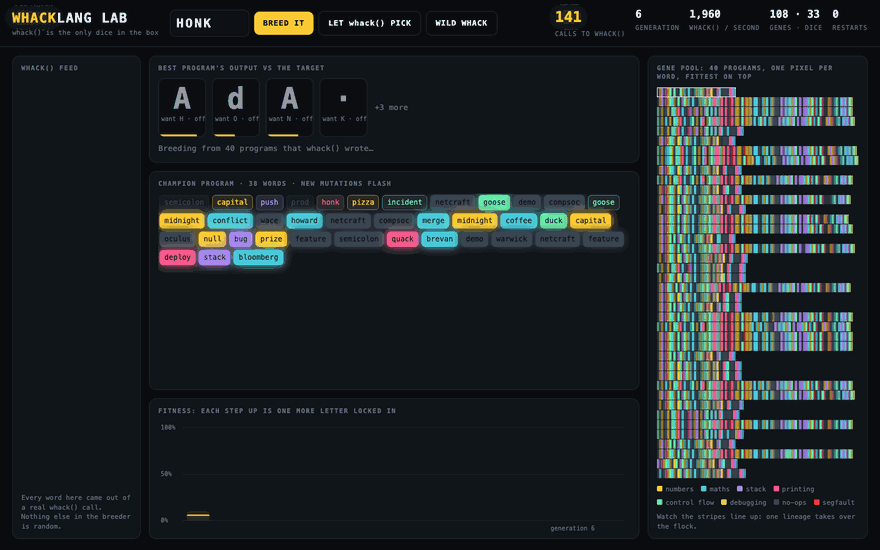

# BrainWhack

**By:** Arnav Popley

**Pitch:** Every whack() output is a valid program. Most of them crash. I bred one that says HONK.

## How to run it

Python 3.9 or newer, standard library only.

```
cd submissions/arnavpopley
python3 brainwhack.py evolve HONK       # breed a program that prints HONK, saved as bred_HONK.bw
python3 brainwhack.py run bred_HONK.bw  # run any program file
python3 brainwhack.py trace bred_HONK.bw  # step through it one word at a time, with the stack
python3 brainwhack.py census           # run 1,000 wild whack() programs: most of them crash
python3 whack_lab.py                   # the lab, then open http://localhost:8026/?breed=HONK
```

## Screenshot




## What it is

BrainWhack is an esoteric programming language in the Brainfuck tradition, except that the 8 symbols are replaced by the 42 words whack() knows. Each word is 1 instruction for a small stack machine that works on bytes, so `capital` pushes 65, `coffee` adds 1, `honk` prints the top of the stack as a letter, and `duck … goose` is a loop. Some of the sponsors are no-ops. Since every word means something, there is no such thing as a syntax error, and hence every file whack() has ever written is a runnable program. Most of them loop forever, print garbage, or segfault, and `census` runs 1,000 of them so you can watch the same.

The breeder gets around this by evolution rather than by writing the program. whack() is the only source of randomness in the whole project, and `brainwhack.py` never imports `random`. It writes the starting population of 40 programs, supplies every new word a mutation adds, and makes every dice roll by reading its own output as digits in base 42. Programs are scored on how close their output is to the target, the fittest 10 of 40 survive each generation, and the lab shows the gene pool converging live in the browser.

The target is HONK because the first program in a goose language should be Hello World for geese, and because anyone who has crossed Warwick’s campus knows who actually runs it. The bred program in `bred_HONK.bw` honks twice for H and O, then prints N and K in one go with `deploy`, which ships the whole stack.

## The 42 words

BrainWhack is a stack machine that works on bytes (0 to 255). Each of the 42 words whack() can write is one instruction, so any whack() output runs.

| Word | What it does |
|---|---|
| `whack` | no-op |
| `hack` | no-op |
| `duck` | loop start |
| `quack` | print top as a character, then pop it (ducks quack and leave) |
| `goose` | if top isn't 0, fly back to the matching duck |
| `honk` | print top as a character (geese honk and stay) |
| `bug` | swap the top two |
| `feature` | no-op (it's not a bug) |
| `warwick` | no-op (sponsor slot: does nothing, looks great on the slide) |
| `oculus` | no-op (sponsor slot: does nothing, looks great on the slide) |
| `compsoc` | no-op (sponsor slot: does nothing, looks great on the slide) |
| `marshall` | no-op (sponsor slot: does nothing, looks great on the slide) |
| `wace` | no-op (sponsor slot: does nothing, looks great on the slide) |
| `brevan` | top * 2 |
| `howard` | top / 2 |
| `capital` | push 65 (capital A) |
| `one` | push 1 |
| `bloomberg` | push the sum of the whole stack |
| `netcraft` | no-op (sponsor slot: does nothing, looks great on the slide) |
| `incident` | if top is 0, skip the next word |
| `io` | print top as a number |
| `pizza` | push 8 (slices) |
| `coffee` | top + 1 |
| `sleep` | top - 1 |
| `deploy` | ship it: print the whole stack, then clear it |
| `merge` | pop b, a; push a + b |
| `conflict` | pop b, a; push a - b |
| `commit` | drop top |
| `push` | duplicate top |
| `prod` | no-op (works on my machine) |
| `segfault` | halt: Segmentation fault (core dumped) |
| `null` | push 0 |
| `pointer` | rotate the third item to the top |
| `stack` | push the stack depth |
| `overflow` | pop b, a; push a * b (wraps at 256) |
| `semicolon` | no-op (optional, like in JavaScript) |
| `rubber` | rubber duck debugging: print what's on the stack |
| `demo` | no-op (demo mode) |
| `pitch` | no-op |
| `prize` | push 100 |
| `midnight` | push 12 |
| `wifi` | skip the next word (packet dropped) |

## How evolve works

1. whack() is the only randomness: the breeder never imports `random`, and every choice it makes is read from whack() words as digits in base 42.
2. whack() is the alphabet: the first 40 programs are raw whack() outputs, and every word that ever enters a program comes from a whack() call.
3. whack() is the mutation operator: each child splices in words from a fresh whack(), swaps one word for one, or crosses over or deletes at positions whack() picks.
4. Programs score 1,000 points per correct leading letter plus closeness on the next one, the fittest 10 of 40 survive each generation, and the winner is pruned to the words that matter.
