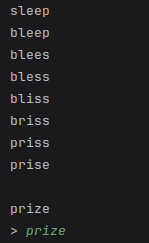

# Your hack's name

**By:** Ollie Barnard (butterflyfish1928)

**Pitch:** finds all pairs of generated words of the same length and allows the user to play a word ladder style game to get from one to the other 

## How to run it

```
python Ollie.py
```

## Screenshot



<!-- Put the screenshot (or better, a GIF) in this folder. It's the first thing I'll look at. -->
