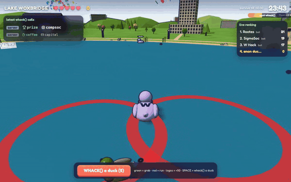
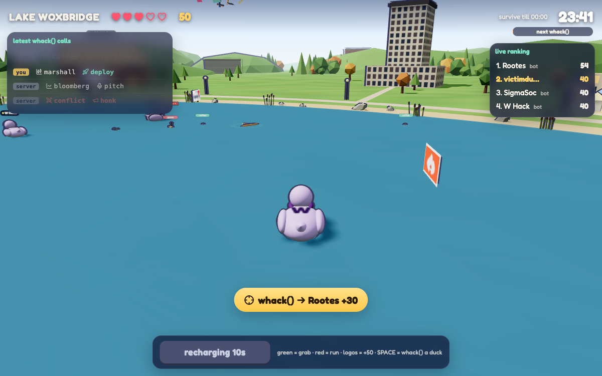

# Warwick Quack Soc Social 🦆

**By:** Anson (GitHub: chocoliticekreem)

**Pitch:** You are a whacky quacky duck on Lake Woxbridge, by the Oculus. Every word `whack()` writes spawns something on the lake, and you can aim your own `whack()` at other ducks.

**Play it online, no sign-up:** https://whackquack.vercel.app (send it to a friend and whack each other)

## How to run it

```
node server.js
```

Then open http://localhost:3026. There are no dependencies, just Node 18+ and a browser. Three.js loads from a CDN.

**W/S** swim · **A/D** turn · **SPACE** `whack()` another duck (10s cooldown) · **ENTER** play

## Screenshot





## How whack() runs the game

`whack.js` is copied in unchanged. Every 4 seconds the server calls it, and every word it writes spawns something on the lake. The rule is simple: **red = run, green = grab, logos = +50**.

| Word | What spawns | |
|---|---|---|
| `goose` / `honk` | geese that hunt you (red ring under each one) | 🔴 −1 ❤ if they reach you |
| `prod` | a meteor, with a red target circle where it will land | 🔴 −1 ❤ if you're inside |
| `segfault` | core dumped | 🔴 −10 points |
| `pizza` / `coffee` | food on the lake | 🟢 +25 (pizza +1 ❤, coffee speed) |
| `bug` → `feature` | ladybirds on the shore; some turn gold | 🟢 +10 / +50 |
| `marshall` `wace` `brevan` `howard` `capital` `one` `bloomberg` `netcraft` `incident` `io` | that sponsor's real logo floats on the lake (when its word appears 2+ times) | 🟢 +50 |
| everything else | ducks, rubber ducks, fireworks, confetti, campus buildings lighting up | scenery |

The left panel shows each `whack()` call as it lands, newest on top, coloured by who called it.

Scoring: +10 for each `whack()` you survive, +25 per food, +50 per logo, +30 when your `whack()` lands on another duck, and up to +500 for making it to midnight 🏆. You have 5 hearts.

## Multiplayer

Every duck online sees the others with name tags. SPACE calls `whack()` and sends the whole word list to a random live player, so their geese and meteors come from you. Five seconds later their game reports back: +15 for each heart they lost, +100 for a KO, or "they dodged it". One target per throw and a 10-second cooldown keep a 20-duck lake from turning into a massacre.

Every game also has 3 bots, **Rootes**, **SigmaSoc** and **W Hack**. They make their own real `whack()` calls and throw them at you, and you can whack them back, so solo play is never empty.

Rounds are shared 1-minute windows, so everyone online hits midnight together. A live ranking runs during play. The menu shows the top 5 for this round, last round (with the winner 👑) and all time, keeping each duck's best score.

The hosted version runs the same `whack.js` in a Vercel function, from `/tmp` because that's the only writable folder there. Positions sync over Supabase Realtime, and scores are stored in Supabase.
