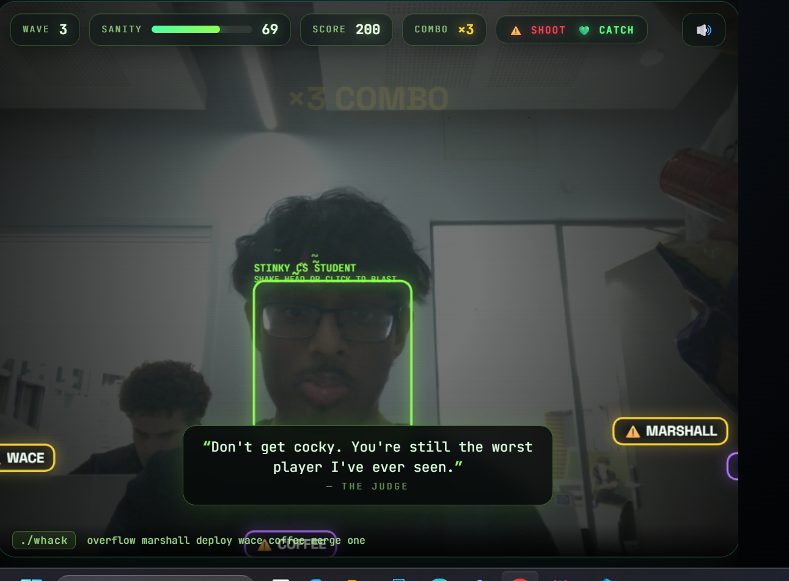

# The Stinky CS Student

**By:** Vaibhav D @coderdino

**Pitch:**  An infinite, face-tracking 2D web game where an unhinged AI narrator relentlessly roasts you while you blast whack words out of the air.

## How to run it

**Prerequisites:** You need [Python](https://www.python.org/downloads/) installed on your computer.

1. **Open a terminal** and navigate to this project folder.
2. **Create and activate a virtual environment** (recommended):
   - **Windows:**
     ```bash
     python -m venv venv
     venv\Scripts\activate
   - **Mac/Linux:**
     python3 -m venv venv
     source venv/bin/activate
3. **Install the requirements:**
   pip install -r requirements.txt

4. **Run the App:**
    - python app.py (on Mac/linux could run with python3 app.py)


## Screenshot



<!-- Put the screenshot (or better, a GIF) in this folder. It's the first thing I'll look at. -->
