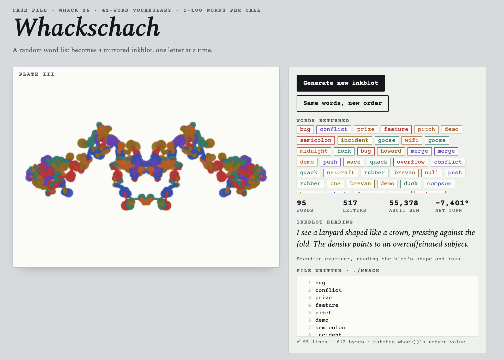

# Whackschach

**By:** Kian Tamjidi - kian3528

**Pitch:** Every whack() call becomes a Rorschach inkblot, steered letter by letter by ASCII codes.

## How to run it

```
bun server.ts
```

Then open http://localhost:3000. Click **Generate new inkblot** to call the real `whack()`. The page shows the returned words and the `./whack` file it wrote, then checks that they match.

## How the blot is drawn

The app turns the words returned by `whack()` into a pen path. It reads them in order and draws each word in the colour of its category. Every letter changes the pen's direction and distance; every word ends in an ink splat. The path is fitted into the left half of the plate and mirrored across the fold. Longer calls use lighter, thinner ink so the image keeps its detail.

**Example — `duck`:** Its letter codes add up to 423, so the pen turns +63° before drawing the letters (423 mod 360). Then `d`, `u`, `c`, `k` turn it −57°, +45°, −63°, and −15°, while moving it 10, 16, 8, and 10 units. `duck` belongs to the bird category, so its strokes and splat use the bird ink.

For a letter with ASCII code `c`, the drawing rules are:

- Before each word, turn by the sum of its letter codes modulo 360°.
- For each letter, turn `(c − 109.5) × 6°`, move `6 + 2 × (c mod 7)` units, and use stroke width `2 + (c mod 5)`.
- At the end of each word, add a category-colored splat with radius `3 + 2.2 × word length`.

## Screenshot


