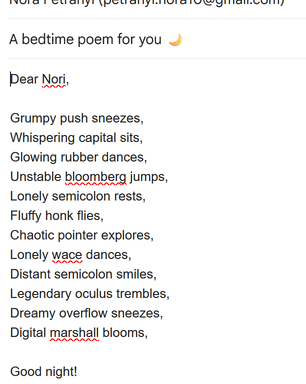

# Bedtime poem email

**By:** Lilla Petrányi (Lxllx13)

**Pitch:** It creates a story from the words generated by the whack function (and others)

## How to run it

```
python main.py
```

## Screenshot



<!-- Put the screenshot (or better, a GIF) in this folder. It's the first thing I'll look at. -->
