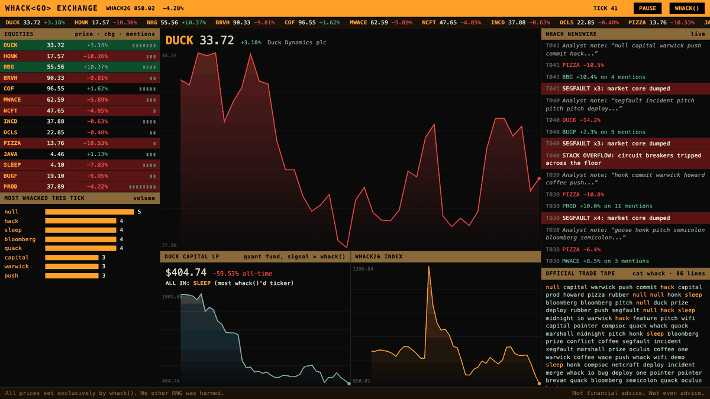
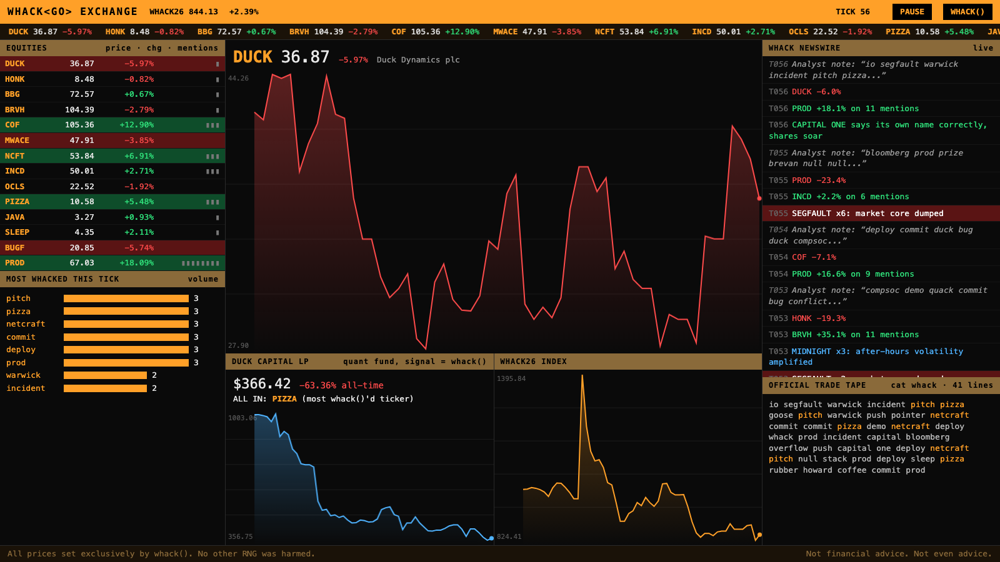

# THE WHACK EXCHANGE 📈🦆

**By:** Rithvik Badiadka (Discord: rbadiadka7)

**Pitch:** A live stock market where `whack()` is the **only source of truth**. Every tick it calls `whack()`, and the words it writes decide everything that happens: sponsor stocks go up when they get mentioned, word pairs trigger corporate scandals, `segfault` crashes the market, and a quant hedge fund confidently goes all in on whatever `whack()` said most. (It is not going well for the fund.)



## How to run it

```
cd submissions/rbadiadka7
python3 exchange.py
```

It opens a Bloomberg-style terminal at http://localhost:8026. Python 3.9+, standard library only, nothing to install.

No browser? `python3 exchange.py --cli 30` prints the live newswire to your terminal instead.

## How `whack()` runs the market

There is **no other randomness in this program**. No `random`, no seeds, nothing but `whack()`. Every tick:

1. **`whack()` is called.** The 1–100 words it returns are that tick's trading activity, and the line count is the **trading volume**.
2. **The `whack` file is read back as the official trade tape**, shown live in the terminal (`cat whack`).
3. **Supply & demand:** every stock is tied to some of the 42 words. A stock moves by how many times it got mentioned *compared with how many mentions you'd expect* from that many random words.

| Ticker | Company | Moved by |
|---|---|---|
| `DUCK` | Duck Dynamics plc | duck, quack, rubber |
| `HONK` | Goose Holdings (Hostile) | goose, honk |
| `BBG` `BRVH` `COF` `MWACE` `NCFT` `INCD` `OCLS` | our lovely sponsors | their names |
| `PIZZA` / `JAVA` | Pizza & coffee futures | pizza / coffee |
| `SLEEP` | Sleep Inc | sleep (goes **down** when mentioned: talking about sleep isn't getting it) |
| `BUGF` / `PROD` | Bug & Feature LLP / Deploy-to-Prod Corp | bug, feature / deploy, prod, push, commit, merge |

4. **Corporate events** fire when `whack()` happens to put two words next to each other:

- `capital` → `one`: *"CAPITAL ONE says its own name correctly, shares soar"*
- `brevan` → `howard`: *"BREVAN HOWARD spotted in correct order, macro desk rejoices"*
- `incident` → `io`: *"INCIDENT.IO declares incident. Business is booming"*
- `goose` → `duck`: *"HOSTILE TAKEOVER: Goose Holdings honks at Duck Dynamics"*
- `null` → `pointer`: a stock gets dereferenced and loses 30% of itself
- `merge` → `conflict`: **two stocks swap share prices**
- `stack` → `overflow`: circuit breakers trip across the whole floor
- `bug` → `feature`: *"BUG RECLASSIFIED AS FEATURE. Analysts: 'genius'"*
- `pizza` → `midnight`: *"MIDNIGHT PIZZA SHORTAGE: Hawaiian futures go parabolic"*
- `deploy` → `prod`, `push` → `prod`, `rubber` → `duck`, `pitch` → `prize`, ...

5. **Macro shocks:** each `segfault` core-dumps the whole market, `midnight` boosts after-hours volatility, 3+ `wifi`s **halt trading** (big red screen), a single-word tick is a **liquidity crisis**, and 95+ words is a **WHACK bubble**.
6. **Duck Capital LP**, a quant fund with a very simple strategy: sell everything, then go all in on the ticker `whack()` mentioned most. Its performance chart is the most honest thing in finance.
7. **The newswire** writes headlines from all of the above, plus an "analyst note" that is just the first words of `whack()`. It reads exactly like real analyst notes.

## Screenshot



Click any ticker to chart it. **PAUSE** freezes the market. **WHACK()** forces one tick yourself, for when you want to personally cause a crash.

*Not financial advice. Not even advice.*
