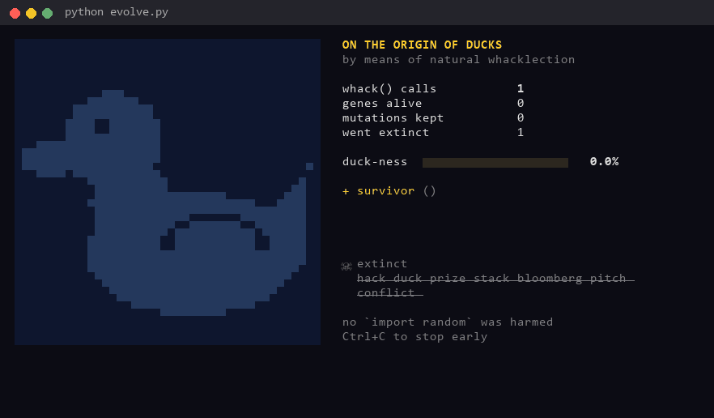
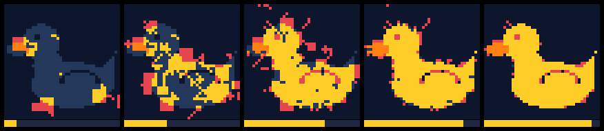
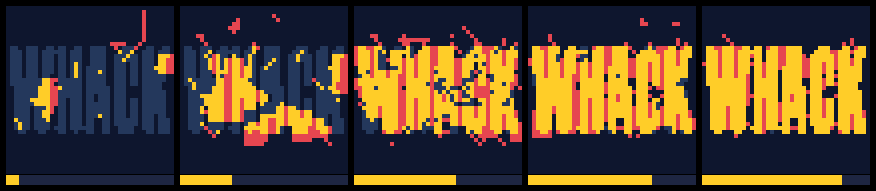
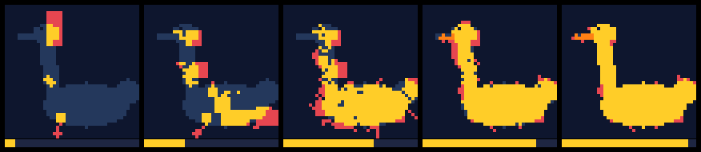

# On the Origin of Ducks 🦆

**By:** timothycuteaf-oss

**Pitch:** I made whack() the only source of randomness in a tiny universe and let natural selection turn its word soup into a rubber duck.

## How to run it

```
cd submissions/timothycuteaf-oss
python evolve.py                     # evolve a duck, 20k whack() calls, takes about 10s
python evolve.py --hatch duck.dna    # regrow the duck from its DNA
python evolve.py --target goose.txt  # evolve a goose instead
python evolve.py --target WHACK.txt 40000  # evolve the word WHACK out of whack() words
```

Python 3.9+ and nothing to install. It also writes `evolution.gif`, `fossil_record.png` and `duck.dna`. I hand rolled the GIF and PNG encoders because I didn't want anyone pip installing stuff at midnight.

## Screenshot



Here's the fossil record after 30, 150, 600, 2,000 and 20,000 whack() calls:



It can spell WHACK too. Yeah, it evolves the word WHACK out of whack() words, which is a bit meta:



## How it works

There's no `import random` anywhere in this. whack() is the only dice.

Every whack() call is one gene, and every gene is one brushstroke. The pond is 42x42 because there are 42 words. The first two words pick where the stroke starts, the number of words picks which way it's facing, and every word after that tells the brush what to do. `duck` moves down, `segfault` kills the stroke, that kind of thing. Full table's at the bottom.

Each generation makes exactly one whack() call. Its last word decides what happens: a new gene gets born, an old one gets a fresh tail spliced on, one gets swapped out completely, or one gets culled. Its first word and its length decide which gene gets hit.

Then selection does the rest. If a mutation makes the pond look less like a duck, it goes extinct.

The run in the GIF took 20,000 whack() calls. 18,913 mutations died. What's left is a 93.1% duck made of 49 genes and 897 words.

The bit I like most is `duck.dna`. It's just a text file of whack words, and it is the duck. Run `--hatch duck.dna` and the exact same duck grows back.

In the terminal, yellow is duck, orange is beak, red is stray paint selection hasn't caught yet, and the faint blue is the duck it's trying to become. The panel on the right shows the last whack() call that survived and the last one that died.

## Bring your own creature

Draw anything up to 42x42 in a text file (`#` for body, `@` for beak) and pass it in with `--target`. I added a goose because the word list has goose and honk in it, so it felt rude not to.



## The genetic code

| word | what the brush does | why |
|---|---|---|
| `duck` | moves ↓ | duck |
| `goose`, `honk` | moves ↑ | geese fly |
| `pitch` | moves ↗ | pitch it up |
| `push`, `deploy` | moves → | ship it |
| `commit`, `prod` | moves ↘ | it's all downhill once you commit to prod |
| `bug` | moves ↙ | bugs live in corners |
| `merge` | moves ← | merge left |
| `rubber` | moves ↖ | rubber bands snap back |
| `feature` | turns right and steps | every feature is a pivot |
| `hack` | turns left and steps | |
| `conflict` | does a u-turn | merge conflict |
| `null` / `pointer` | pen up / pen down | |
| `quack` | splats a + | it's loud |
| `pizza` | stamps a 3x3 slice | |
| `whack` | stamps a 5x5 crater | WHACK |
| `coffee` / `sleep` | double speed / normal speed | |
| `stack` / `overflow` | saves its spot / jumps back to it (empty stack means underflow and the stroke dies) | |
| `wifi` | teleports 6px without drawing | the signal dropped |
| `segfault`, `midnight` | kills the stroke | crash, or deadline |
| `semicolon`, `demo`, `prize` | does nothing | nothing ever works in the demo |
| the sponsors (`warwick` `oculus` `compsoc` `marshall` `wace` `brevan` `howard` `capital` `one` `bloomberg` `netcraft` `incident` `io`) | keep going forward | sponsors keep you moving |

The official whack.py is in here, untouched.
